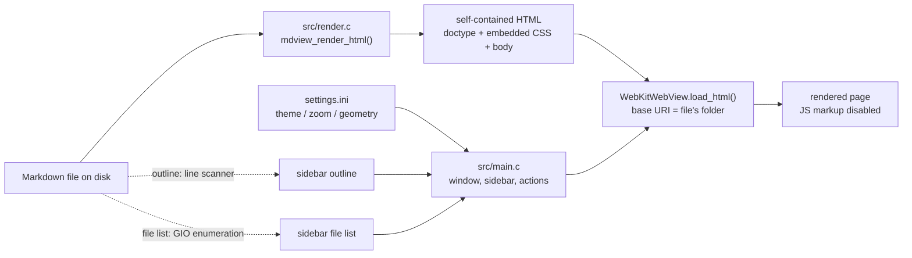

# mdview — how it works

This document explains what mdview does under the hood, why it is built that
way, and every knob a user can turn. It is a companion to the
[README](../README.md); this page assumes you have read it.

Everything described here is traced to the shipped source. Where a claim is
verified by an executed command rather than by reading, it is marked as such in
[Verified claims](#verified-claims).

---

## 1. How it works

### The two halves

mdview is split into a GUI-free renderer and a GTK shell around it.



The split is the central design decision. `src/render.c` depends only on GLib
and md4c; it includes no GTK and no WebKit headers. `src/main.c` depends on GTK
and WebKit. The renderer is therefore reachable from three places that share one
implementation: the GUI (`load_file`), the headless CLI (`--render`) and the
unit tests (`make check`).

**Why:** a renderer that needs a display cannot be unit-tested, cannot be
driven from a script, and cannot be reused for static export. Making the
pipeline GUI-free means the output can be pinned by string assertions in
`tests/render_test.c` and regenerated on demand with `mdview --render`.

### Rendering: md4c → self-contained HTML

`mdview_render_html()` calls md4c's HTML renderer with a fixed flag set:

```c
#define MD_PARSER_FLAGS  (MD_FLAG_TABLES | MD_FLAG_TASKLISTS | \
                          MD_FLAG_STRIKETHROUGH | MD_FLAG_FOOTNOTES)
#define MD_RENDER_FLAGS  (MD_HTML_FLAG_SKIP_UTF8_BOM)
```

The parser flags enable the GitHub-flavoured extensions; the render flag drops
a leading UTF-8 BOM. `MD_HTML_FLAG_VERBATIM_ENTITIES` is **not** set, and no
`NOHTML*` flag is set, so raw HTML is passed through as-is.

The body produced by md4c is wrapped by `build_document()` into a complete
document:

```
<!DOCTYPE html>
<html lang="en" data-theme="light|dark">
<head>
  <meta charset="utf-8">
  <meta name="viewport" ...>
  <title>…escaped…</title>
  <style> …the whole stylesheet… </style>
</head>
<body> …rendered markdown… </body>
</html>
```

Two details matter:

- **The stylesheet is embedded in every page.** `mdview_css()` returns one
  string containing both the light (`:root`) and dark
  (`html[data-theme="dark"]`) palettes, all typography rules, table striping,
  blockquote, code, footnote and scrollbar styling. There is no external CSS
  file to ship, cache or resolve.
- **The `<title>` is escaped** with a small `&`/`<`/`>`/`"` escaper, so a
  filename containing markup characters cannot inject into the document head.
  The theme is emitted as a `data-theme` attribute; `theme_attr()` maps anything
  other than exactly `"dark"` to `"light"`.

**Why a self-contained document:** the output of `--render` is a file you can
move, email or open elsewhere and it still looks right. It also means the GUI
loads a document rather than a document plus a stylesheet reference, so there
is no second request to fail.

### Display: WebKitWebView with JavaScript markup disabled

`build_ui()` creates a `WebKitWebView` and configures it:

| Setting | Value | Why |
| --- | --- | --- |
| `enable-javascript` | `true` | The application itself evaluates JavaScript after each load. |
| `enable-javascript-markup` | `false` | **The security boundary.** Inline `<script>` in Markdown's raw HTML must not run. |
| `allow-file-access-from-file-URLs` | `true` | Lets the page load relative images and local assets from `file://`. |
| `enable-developer-extras` | `false` | No inspect-element affordance in a reader. |
| `enable-back-forward-navigation-gestures` | `false` | A reader should not trigger navigation from a swipe. |
| `editable` (on the view) | `false` | Viewer, not editor. |

This is the non-obvious part of the security design. WebKitGTK distinguishes
*two* JavaScript switches. `enable-javascript` controls whether JavaScript can
run at all; `enable-javascript-markup` controls whether `<script>` elements
found in the loaded markup execute. mdview needs the first for its own theme and
scroll scripts, and needs the second off so document-supplied scripts stay
inert. Setting only `enable-javascript` to `false` would break the app's own
scripts; setting only `enable-javascript-markup` to `false` is the precise
control that is wanted.

**Why raw HTML is still passed through:** disabling JavaScript markup is not
sanitisation. md4c emits raw HTML blocks and inline HTML unchanged, so
`<script>`, `` and similar markup appear in the DOM. They are
inert because the scripts never execute — but the document is not "safe HTML",
and mdview makes no claim that it is. `tests/js_markup_probe` exists to keep
this distinction honest.

### Base URI: relative images and inter-Markdown links

`load_file()` renders the file, then computes the directory URI and loads the
HTML with it as the base:

```c
char *dir_uri = file_dir_uri(file);
webkit_web_view_load_html(a->webview, html, dir_uri);
```

`file_dir_uri()` takes the file's parent folder, converts it with
`g_filename_to_uri()`, and appends a trailing `/` if missing. That base URI is
what makes a relative `` resolve against the Markdown
file's own folder rather than against the application or the current working
directory.

The same mechanism powers links between Markdown files. The `decide-policy`
handler intercepts link clicks and, for a `file://` URL whose path has a
Markdown extension, loads that file instead of navigating away:

- Non-`file:` URLs (and `about:`/`data:`) are handed to `GtkUriLauncher`, i.e.
  the system default browser, and the in-view navigation is ignored.
- A `file://` link to another Markdown file loads it rendered in the viewer.
- A `file://` link that resolves to the **currently open** file but carries a
  `#fragment` is treated as a same-document anchor and left to the web view, so
  it scrolls in place.

**Why:** a Markdown file is usually part of a tree of files that reference each
other and share an `img/` folder. Resolving against the file's own folder —
not the working directory — is what makes such a tree readable as a unit.

### Two passes: file list vs. outline

The sidebar has two pages, and they are built by two completely different
mechanisms. This is deliberate, because they answer different questions.

**File list — GIO enumeration (`refresh_file_list`).** The current folder is
enumerated with `g_file_enumerate_children()` asking for the standard name and
type attributes. Directories are skipped, names are filtered by
`is_markdown_path()` (extension match against `md`, `markdown`, `mdown`,
`mkd`, `mkdn`, `mdwn`, `mkdown`), collected into an array, sorted by name with
`g_strcmp0`, and rendered as rows. A `..` row pointing at the parent folder is
prepended. This is a filesystem query: it reflects what is on disk right now.

**Outline — a line scanner (`mdview_outline_extract`).** The outline is
computed from the document text, not from the filesystem. The scanner walks
line by line and:

- Tracks fenced code blocks. A fence opens with three or more `` ` `` or `~`
  after at most three leading spaces; a backtick fence is rejected if the
  remainder of the line contains another backtick. A closing fence must use the
  same character, be at least as long, and have nothing but whitespace after it.
  Heading-like lines inside a fence are ignored.
- Recognises ATX headings only: one to six `#`, preceded by at most three
  spaces (more indentation means an indented code block, not a heading), and
  followed by end-of-line or whitespace.
- Strips a closing sequence of `#` characters, trailing whitespace, and inline
  Markdown syntax via `plain_heading()` so the outline label matches the
  rendered text: emphasis markers, code fences, `~~`, `__`, links (label only),
  images (alt text only), inline HTML tags and backslash escapes.
- Skips empty headings.

**Why two passes:** the file list is a property of the directory and must agree
with the filesystem; the outline is a property of one document and must agree
with what was rendered. Reusing one mechanism for both would mean either
parsing Markdown to list files or stat-ing the disk to build an outline — both
wrong. The outline scanner's fence handling is what keeps `#` comments inside
code blocks out of the outline, which the `fenced-code` and `tilde-fence` test
cases pin.

**Why the outline is only ATX:** the scanner looks for a `#` prefix. A Setext
heading has no such prefix, so it is rendered by md4c but absent from the
outline. This is a known, tested limitation (`setext-skipped`).

### Clicking an outline entry

Outline rows store the heading's plain text. Activating one runs a small script
in the page:

```js
(()=>{const t=<text>;const hs=[...document.querySelectorAll('h1,h2,h3,h4,h5,h6')];
const h=hs.find(e=>e.textContent.trim()===t);
if(h){h.scrollIntoView({block:'start'});return '1';}return '0';})()
```

The text is escaped with `js_escape()` (backslash, quote, newline, carriage
return, tab, and other control characters as `\uXXXX`) before being interpolated
into the script literal, so a heading containing a quote or newline cannot break
out of the string.

### Theme switching

The document's palette is driven by the `data-theme` attribute on `<html>`.
`apply_theme_js()` is called after each load finishes (`load-changed`) and on
theme change:

- `dark` → `document.documentElement.dataset.theme='dark'`
- `light` → `…='light'`
- anything else (`system`) → read
  `window.matchMedia('(prefers-color-scheme: dark)').matches` and set `'dark'` or
  `'light'` accordingly.

**Why a script rather than a re-render:** flipping one attribute restyles the
whole page through the existing CSS custom properties, with no reload and no
re-parse of the Markdown. The trade-off is that the attribute is set
asynchronously after load, so a page can flash its initially embedded theme for
a moment. The embedded attribute is the server-side (or CLI-side) default, and
`system` pages therefore start light until the script corrects them.

### Settings lifecycle

`load_settings()` reads `~/.config/mdview/settings.ini` at startup, group
`[General]`, and applies range checks before accepting each value. Values
outside the accepted range are discarded and the compiled-in default is kept.
`save_settings()` writes the file, creating the directory with mode `0700`.

The sidebar's initial folder is `last-dir` if it is set and is an existing
directory, otherwise the user's home directory.

---

## 2. Benefits and the mechanisms that earn them

| Claimed benefit | Mechanism that earns it | Where in the source |
| --- | --- | --- |
| Raw HTML in Markdown cannot run scripts | `enable-javascript-markup = false` while `enable-javascript` stays `true` for app scripts | `src/main.c` (`build_ui`) |
| Relative images resolve next to the document | `file_dir_uri()` sets the load base URI to the file's parent folder | `src/main.c` (`file_dir_uri`, `load_file`) |
| Links between Markdown files stay in the viewer | `decide-policy` intercepts `file://` navigation to Markdown paths and calls `load_file` | `src/main.c` (`on_decide_policy`) |
| External links do not navigate the reader away | Non-`file:`/`about:`/`data:` URLs are handed to `GtkUriLauncher` and the decision is ignored | `src/main.c` (`on_decide_policy`) |
| The renderer is testable without a display | `src/render.c` has no GTK/WebKit dependency; `make check` links it directly | `src/render.c`, `tests/*.c`, `Makefile` |
| `--render` produces a portable artifact | The stylesheet is embedded in the document; there is no external CSS reference | `src/render.c` (`build_document`) |
| Filenames cannot inject markup into the page | `<title>` text is HTML-escaped before insertion | `src/render.c` (`html_append_escaped`) |
| Outline labels match rendered text | `plain_heading()` strips inline syntax, links → label, images → alt | `src/render.c` (`plain_heading`) |
| `#` comments in code blocks do not pollute the outline | The outline scanner tracks fenced code and skips heading detection inside it | `src/render.c` (`mdview_outline_extract`) |
| Heading clicks cannot inject script | Heading text is `js_escape()`d before interpolation into the script literal | `src/main.c` (`outline_scroll_to`) |
| Theme switches without a reload | A single `data-theme` attribute flip, applied by a post-load script | `src/main.c` (`apply_theme_js`) |
| The window returns to where you left it | Settings are persisted to `settings.ini` on quit, zoom, theme change, fullscreen and close | `src/main.c` (`save_settings`) |
| A dropped file just opens | A window-level `GtkDropTarget` accepts a file path or `file://` URI | `src/main.c` (`on_drop`) |

---

## 3. Every user option

### Menu actions

| Menu item | Action name | Notes |
| --- | --- | --- |
| Open… | `app.open` | Opens a `GtkFileDialog` filtered to Markdown. |
| Find in Page… | `app.find` | Shows the find bar and focuses it. |
| Zoom In | `app.zoomin` | Multiplies zoom by 1.15, clamped to 0.5–3.0. |
| Zoom Out | `app.zoomout` | Divides zoom by 1.15, clamped to 0.5–3.0. |
| Reset Zoom | `app.zoomreset` | Sets zoom to 1.0. |
| View → Sidebar | `app.sidebar` | Stateful toggle; forced off in fullscreen. |
| View → Fullscreen | `app.fullscreen` | Toggles `gtk_window_fullscreen`; hides the sidebar while active. |
| View → Theme → System / Light / Dark | `app.theme::system` / `::light` / `::dark` | Stateful radio-style action; persisted. |
| About Markdown Viewer | `app.about` | GTK about dialog; MIT/X11 license shown. |
| Quit | `app.quit` | Saves settings, then quits. |

`Esc` (`app.escape`) closes the find bar; it is bound but has no menu item. The
find bar itself has three buttons — find previous, find next and close — and
pressing Enter in the entry repeats the search when the text is unchanged, or
starts a new case-insensitive, wrap-around search otherwise.

### Keyboard accelerators

| Accelerator | Action |
| --- | --- |
| `Ctrl+O` | `app.open` |
| `Ctrl+F` | `app.find` |
| `Escape` | `app.escape` |
| `F11` | `app.fullscreen` |
| `Ctrl+B` | `app.sidebar` |
| `Ctrl+plus`, `Ctrl+equal` | `app.zoomin` |
| `Ctrl+minus` | `app.zoomout` |
| `Ctrl+0` | `app.zoomreset` |
| `Ctrl+Q` | `app.quit` |

### Settings file

`~/.config/mdview/settings.ini`, group `[General]`.

| Key | Default | Accepted | What it flips |
| --- | --- | --- | --- |
| `theme` | `system` | `system`, `light`, `dark` | Colour scheme; `system` follows the OS. Any other string is stored but renders as light. |
| `zoom` | `1.0` | `0.3` – `3.0` | Page zoom. Interactive zoom clamps to `0.5` – `3.0`. |
| `width` | `1280` | `> 320`, `< 8000` | Initial window width. |
| `height` | `820` | `> 240`, `< 8000` | Initial window height. |
| `sidebar-pos` | `260` | `> 120`, `< 2000` | Sidebar divider position. |
| `last-dir` | *(unset)* | existing directory | Startup folder for the sidebar; unset falls back to `~`. |

The sidebar starts visible. Settings are written on quit, zoom, theme change,
fullscreen toggle and window close; the config directory is created `0700`.
### Command-line flags

| Flag | Argument | Effect |
| --- | --- | --- |
| *(none / a file path)* | — | Opens the GUI; a file path is opened. |
| `--render` | `INPUT.md OUTPUT.html` | Renders to a self-contained HTML file and exits; no display needed. Requires **both** paths. |
| `--version` | — | Prints `mdview 1.0`. |
| `--help`, `-h` | — | Prints the usage block. |

Two further flags come from GTK/GLib itself, not from mdview's own argument
loop, and are visible in `mdview --help-all`:

| Flag | Effect |
| --- | --- |
| `--help-all` | Prints GLib/GApplication option help, then exits. |
| `--gapplication-service` | Enters GApplication service mode (for D-Bus service files). |

Because these are handled by the application framework, an unrecognised option
(such as `--render` with too few arguments) is reported by GLib as
`Unknown option …` and the process exits non-zero.

### Desktop entry

`mdview.desktop` declares the application to the desktop environment:

| Key | Value | Effect |
| --- | --- | --- |
| `Name` | `Markdown Viewer` | Launcher label. |
| `GenericName` | `Markdown Viewer` | Menu grouping. |
| `Comment` | `Distraction-free viewer for Markdown files` | Tooltip / description. |
| `Exec` | `mdview %U` | `%U` passes the file URI(s) to open. |
| `Icon` | `text-markdown` | Resolves to the installed `text-markdown.svg`. |
| `Terminal` | `false` | No terminal window. |
| `Categories` | `Utility;Viewer;` | Menu categorisation. |
| `MimeType` | `text/markdown;text/x-markdown;` | Files of these types can be opened with mdview. |
| `StartupNotify` | `true` | Startup feedback is requested. |

The file-open dialog's Markdown filter matches MIME types `text/markdown` and
`text/x-markdown` plus the patterns `*.md`, `*.markdown`, `*.mdown` and
`*.mkd`. The sidebar's file list uses the broader extension list
(`md`, `markdown`, `mdown`, `mkd`, `mkdn`, `mdwn`, `mkdown`).

### Environment variables

mdview's own code reads no environment variables directly. The variables that
matter are the ones the underlying toolkit consumes:

| Variable | Effect |
| --- | --- |
| `XDG_CONFIG_HOME` | Relocates `settings.ini` (via `g_get_user_config_dir()`); the file moves to `$XDG_CONFIG_HOME/mdview/settings.ini`. |
| `XDG_DATA_HOME` | Relocates the installed `.desktop` file and icon when `PREFIX` is not overridden, because `make install` writes under `$HOME/.local` which XDG uses. |
| `HOME` | Used for the `~` abbreviation in the header-bar subtitle and as the fallback sidebar folder. |
| `GDK_BACKEND` | Selects the GTK backend (for example `broadway` for headless use). Not required for normal desktop use. |
| `BROADWAY_DISPLAY` | Broadway display number, used with `GDK_BACKEND=broadway`. |
| `DISPLAY` / `WAYLAND_DISPLAY` | Standard display selection, read by GTK/GDK. |
| `WEBKIT_DISABLE_COMPOSITING_MODE`, `WEBKIT_FORCE_SANDBOX` | Standard WebKitGTK tuning variables, read by the library rather than by mdview. |

### Other constants

| Constant | Value | Where |
| --- | --- | --- |
| Application ID | `io.github.rahlquist.mdview` | `APP_ID` in `src/main.c` |
| Version | `1.0` | `APP_VERSION`; also `Version=` in `mdview.desktop` |
| Sidebar width request | `250` px | `gtk_widget_set_size_request(box, 250, -1)` |
| Sidebar outline indent | `12 + (level − 1) × 14` px | `refresh_outline` |
| Content max width | `880 px` | `.content` in the embedded stylesheet |
| Find behaviour | case-insensitive, wrap-around | `WEBKIT_FIND_OPTIONS_*` in `on_find_activate` |

---

## 4. Verified claims

Everything in this section was executed on the machine that built the shipped
`mdview` binary. Build dependency versions observed:

| Package | Version |
| --- | --- |
| GTK (`gtk4`) | 4.24.1 |
| WebKitGTK (`webkitgtk-6.0`) | 2.54.2 |
| GLib (`glib-2.0`) | 2.90.1 |
| md4c / md4c-html | 0.6.0 |
| GCC | 16.2.1 |

### Build and tests

```sh
make
```

Result: exit `0`. It compiles `src/main.c` and `src/render.c` and links
`mdview` against `-lwebkitgtk-6.0 -lgtk-4 … -lmd4c -lmd4c-html`. No warnings
were reported by `-Wall -Wextra`.

```sh
make check
```

Result: exit `0`.

```
tests/outline_test
outline_test: all 9 cases passed
tests/render_test
render_test: all checks passed
```

This confirms the outline extractor (9 cases, including fenced code, tilde
fences, indented code, inline formatting, links/images, trailing hashes,
backslash escapes, setext skipped, empty input) and the renderer (doctype,
theme attribute, title escaping, headings, tables, task-list checkboxes, code
block language class, blockquote, strikethrough, strong, inline code, footnote
reference and definition, and the embedded stylesheet).

### CLI

```sh
./mdview --version     # → mdview 1.0            (exit 0)
./mdview --help        # → usage block           (exit 0)
./mdview --render tests/sample.md /tmp/out.html
```

`--render` exits `0` and writes a 6430-byte file. Grepping the output for
headings shows the expected rendered structure (`<h1>` … `<h6>`), including
`## Setext heading`, which renders as a heading, and no headings from inside the
fenced block in `tests/sample.md`.

`./mdview --render onlyone` prints `Unknown option --render` and exits `1`. The
argument loop requires `i + 2 < argc`; with a single trailing argument the
`--render` branch is not taken, the loop finishes, and the flag is then
rejected by the GApplication option parser when the GUI path runs.

### Security configuration

```sh
make probe
gtk4-broadwayd :11 --port 8111 &
GDK_BACKEND=broadway BROADWAY_DISPLAY=:11 tests/js_markup_probe tests/js_markup_probe.html
```

Result: `SCRIPT-BLOCKED` (exit `0`).

This is the probe's own verdict on a page containing two `<script>` elements
(a direct assignment and a `DOMContentLoaded` handler). The probe configures
its `WebKitWebView` with the same two settings mdview uses
(`enable-javascript = true`, `enable-javascript-markup = false`), so the
result evidences that configuration under WebKitGTK 2.54.2.

### Raw HTML passthrough

Rendering a document containing `<script>window.__raw=1</script>` and an
`` shows both appear verbatim in the generated HTML. This
confirms the claim in [How it works](#rendering-md4c--self-contained-html) that
disabling JavaScript markup is not sanitisation: the markup is present in the
DOM, but the script does not execute (as the probe above demonstrates).

### GUI rendering path

The windowed application was run under GTK's **broadway** backend
(`gtk4-broadwayd` + `GDK_BACKEND=broadway`) — the same headless route the
project's own README records. The real `mdview` binary launches and stays
running under that backend with a document argument (the process had to be
terminated by timeout; it printed only the expected broadway warnings about
hardware acceleration and the AT-SPI socket).

To observe what the web view actually displays, a small harness reproduced
`load_file()` exactly — the real `mdview_render_html()` from `src/render.c`,
loaded through `webkit_web_view_load_html()` with the base URI set to the
document's folder, and the same `WebKitSettings` block as `src/main.c`
(JavaScript on, JavaScript markup off, file access from file URLs on, view
non-editable). Running it under broadway on `tests/sample.md` reported:

```
PROBE file=sample.md base_uri=file:///…/tests/ html_bytes=6430
PROBE js: THEME=light H[H1:mdview test document / H2:Typography / H2:Code /
     H2:Tables / H2:Task list / H2:Outline fence test / H2:Images and links /
     H2:Footnotes / H2:Setext heading / H3:Deep nesting] IMG[img/test.svg]
```

That confirms, in the actual web view rather than in a string test: the
document loads, the headings render, and the relative image is present with the
expected `src`.

A second run used a document containing a raw `<script>window.__pwned=1;</script>`
and a relative image, under both `light` and `dark` themes:

```
PROBE js: IMG_SRC=img/test.svg COMPLETE=true NATURAL_W=4 THEME=light SCRIPT_RAN=no
PROBE js: IMG_SRC=img/test.svg COMPLETE=true NATURAL_W=4 THEME=dark  SCRIPT_RAN=no
```

This confirms three things on the real GUI path: the relative image **loads**
(`complete=true`, non-zero natural width), the embedded `data-theme` is honoured
by the page, and the document's own `<script>` did **not** run
(`SCRIPT_RAN=no`) even though the application's JavaScript is enabled.

These harnesses are documentation scaffolding, not part of the shipped
application; they live outside the repository. Everything they exercised
(renderer, settings block, base URI, theme attribute) is the shipped code.

### Not interactively verified

The following GUI behaviours are described from `src/main.c` and were **not**
exercised through interaction: menu activation, the find bar's buttons and
Enter behaviour, sidebar row clicks, outline scrolling, drag-and-drop,
fullscreen toggling and the about dialog. No claim in this document about those
rests on an observed session.

---

## 5. Known limits

- **Setext headings are missing from the outline.** The outline scanner only
  recognises ATX (`#`) headings; a Setext heading renders but produces no
  outline row. Pinned by the `setext-skipped` test case.
- **No syntax highlighting.** Code blocks keep their language class but are
  rendered as plain monospace.
- **Raw HTML is not sanitised.** Disabling JavaScript markup neutralises
  scripts, but arbitrary HTML from the document reaches the DOM. A document
  containing, say, a tracking image would still load that image if the page
  were served somewhere that allowed it; mdview's own `file://` base URI and
  markup-script setting are what constrain it.
- **No tabs, no multi-document view.** Opening a file replaces the current
  document.
- **No editor, no save, no export from the GUI.** `--render` is the only export
  path, and it is a command-line operation.
- **Theme is applied asynchronously.** The document embeds a default
  `data-theme`; the `system` choice is resolved by a script after load, so a
  brief flash of the default palette is possible.
- **Outline matching is exact.** An outline row scrolls to the first heading
  whose text content matches exactly; two headings with identical text resolve
  to the first.
- **Sidebar list is extension-filtered.** Files whose extension is not in the
  Markdown list do not appear in the sidebar, even though the file-open dialog
  would open them.
- **Dependencies are current GTK/WebKitGTK 6.0.** Older WebKitGTK (4.1) is not
  supported by this code.
- **GUI verification is limited on headless machines.** The interactive window
  was exercised only under the broadway backend, and only for the rendering
  path; menu, find-bar, sidebar-click and dialog behaviour were not driven
  interactively. See [Verified claims](#verified-claims).
